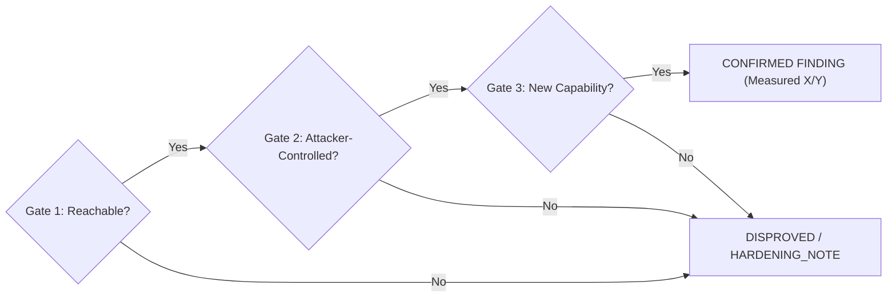

# Security Harness & TedRedCraft Integration Protocol

All repositories, tools, and autonomous agent sessions operating under this harness must integrate and adhere to the security engineering standards established by **TedRedCraft** (`redcraft`).

- **Private Repository URI**: `https://github.com/teddymwai/TedRedCraft`
- **Canonical Workstation Path**: `/Users/ted/Development/TedRedCraft`
- **Core Technology**: 100% Python 3.11+ Standard Library (Zero External Dependencies).

Whenever this template is initialized or an agent executes a task, the agent or operator must consult this advisory to run the appropriate security tooling across the project lifecycle.

---

## 1. Lifecycle Stage Advisory: When to Run Security Tooling

The table below defines the required security verification stages, expected runtimes, and invocation commands:

| Stage | Trigger / Context | Verification Tool & Command | Target Runtime | Scope & Checks Enforced |
|---|---|---|---|---|
| **1. Development** | Iterative coding, authoring locators, refactoring, and local feature work | `python3 -m redcraft selftest`<br>`python3 -m redcraft search "<query>"` | <3 seconds | Offline unit/syntax benchmark. Search prior lessons, waivers, and root causes in `.redcraft/blackboard.db`. Verify `assert_local_loopback_scope(host)`. |
| **2. Pre-Commit** | Staging git changes or executing pre-commit hooks | `python3 -m redcraft audit --target . --mode pre-commit`<br>*(or `tools/git_hooks/pre-commit`)* | <1.5 seconds | **Tier 1 Fast Polyglot SAST**: Scans staged diffs for unredacted secrets, dangerous execution sinks (`eval`, `exec`, unquoted `os.system`/`subprocess`), unconfined path joins (`os.path.join` with user input), unredacted `.har` session cookies, and missing CSRF tokens. |
| **3. Pre-Push** | Preparing branch push or opening pull requests | `python3 -m redcraft audit --target . --mode pre-push`<br>*(or `tools/git_hooks/pre-push`)* | <4 seconds | **Tier 2 Ephemeral Loopback DAST**: Validates running loopback HTTP servers, CSRF defenses, Origin headers, token checks, taint tracing, and bounded lease socket teardown. |
| **4. Live Usage & Deep Audit** | Pre-release verification, security reviews, and Cockpit monitoring | `python3 -m redcraft audit --target . --mode deep-audit --dashboard`<br>`python3 -m redcraft cockpit --port 8790` | On-Demand | **Tier 3 Full Deep Audit & In-Tandem Cockpit Dashboard**: Ephemeral loopback canary testing, complete AST taint tracing, Cairn two-phase recovery, UltraRed `<projectTitle>_<YYYYMMDD_HHMMSS>/mainReport.md` generation, and local web UI (`127.0.0.1:8790`, per-session CSRF token, strict CSP, 1MB limit). |
| **5. Continuous Upstream Distillation** | Learning from external security repositories | `python3 -m redcraft upstream ingest <slug>`<br>`python3 -m redcraft upstream promote <slug>` | Offline | **Loop C Learning Pipeline**: Ingest upstream rules/skills as `status = "observed"`, evaluate Net-Gain vs. Tech-Load dossier, run held-out falsification battery (100% recall on vulnerable fixtures, 0% FP on benign fixtures), and record attested promotion in `docs/decisions.jsonl`. |

---

## 2. The 4 Disciplined Security Rules

All security probes, test runners, and audits must enforce these four architectural invariants:

1. **Rule 1: Explicit Scope-Lock Pre-Flight**:
   Active DAST and pentest operations must strictly call `assert_local_loopback_scope(host)` before opening any network socket. Target hostnames are resolved via `socket.getaddrinfo()` to verify `ipaddress.is_loopback`. Scanning remote production, staging, or unauthorized hostnames is strictly prohibited by architectural design.
2. **Rule 2: Evidence-First Anti-Hallucination Rubric**:
   Classify all security observations into four strict states:
   - `CONFIRMED`: Satisfies all 3 Hard Gates (see Section 3).
   - `CANDIDATE`: Potential vulnerability under active falsification.
   - `DISPROVED`: Proven unreachable, sanitized, or neutralized.
   - `HARDENING_NOTE`: Non-exploitable defense-in-depth recommendation.
   *Eliminations require evidence at the same standard as confirmations.* The auditor must actively try to disprove the candidate finding. **Zero confirmed findings is a valid and acceptable outcome.**
3. **Rule 3: Root-Cause 3-Tuple Deduplication**:
   Group redundant surface findings sharing `(root_cause, component, prerequisite)` into a single canonical finding to eliminate notification fatigue.
4. **Rule 4: Bounded Lease Closeout**:
   Loopback test HTTP servers must execute within ephemeral leases. Sockets must be closed (`server_close()`) and temporary directories wiped in guaranteed `finally:` blocks.

---

## 3. VulnHunter 3 Hard Gates for Confirmed Findings

An issue may **never** be reported as `CONFIRMED` unless it conclusively passes all three gates:



1. **Gate 1 (Reachable)**: Proven execution path from active routes or public interfaces down to the sink in production code.
2. **Gate 2 (Attacker-Controlled)**: The taint source originates from untrusted user input, HTTP request headers, query parameters, or file uploads.
3. **Gate 3 (New Capability)**: The exploit primitive grants an unauthorized capability (arbitrary command execution, file read outside root, horizontal/vertical privilege bypass, or sensitive credential leak).

---

## 4. Sudus 5-Lens Read-Only Adversary Review

Candidate architectural changes, security mitigations, and confirmed findings must be stress-tested through 5 independent lenses:

1. **Falsifier Lens**: Actively seeks counter-examples, existing defense mechanisms, input sanitizers, or deployment constraints that disprove the vulnerability.
2. **Decision Lens**: Verifies that any waivers, exclusions, or exceptions are attested in `docs/decisions.jsonl` with full cryptographic receipt freshness.
3. **Security Lens**: Evaluates the worst-case blast radius, lateral movement potential, and privilege escalation pathways.
4. **Logic Lens**: Identifies state machine race conditions, off-by-one boundary bugs, and assumption mismatches.
5. **Complexity Lens**: Flags over-engineered security wrappers or brittle regex patterns that introduce maintainability hazards.

---

## 5. Mounting TedRedCraft into a Project

To mount TedRedCraft into any project repository, run:

```bash
# If TedRedCraft is cloned locally at /Users/ted/Development/TedRedCraft:
python3 /Users/ted/Development/TedRedCraft/redcraft/cli.py mount --target . --with-ci

# Or via installed module:
python3 -m redcraft mount --target . --with-ci
```

This automatically installs:
- `.redcraft.toml` configured with default branch and gate policies.
- Git hooks: `tools/git_hooks/pre-commit` and `tools/git_hooks/pre-push`.
- Portable security skills in `.agents/skills/`.
- Continuous integration security gate in `.github/workflows/redcraft-security.yml`.

---

## 6. UltraRed Run Reporting Engine & Mandatory Web Surface Confinement

1. **UltraRed Run Reporting (`reports/<projectTitle>_<YYYYMMDD_HHMMSS>/`)**:
   - Every security audit run generates `mainReport.md`, `findings.json`, and `summary.json` anchored to the project title and UTC timestamp (`<projectTitle>_<YYYYMMDD_HHMMSS>`).
   - `mainReport.md` must include the **Executive Scorecard**, **1. What Was Run**, **2. What Was Safe** (verified policy invariants and disproved candidates with evidence), **3. What Needs Immediate Attention** (3 Hard Gates + 3-Tuple deduplication + measured impact denominator `X/Y`), **4. Other Items That Need Attention**, and **5. ARTEX 7-Check Pre-Submission Self-Verification** (reference implementation in `templates/ultrared_reporting.py`).
2. **Four Non-Negotiable Web Surface Security Rules (`SEC-01`..`SEC-04` & `SEC-JS-INNER-HTML`)**:
   - `SEC-01-UNCONFINED-PATH-JOIN`: All file-serving routes must resolve paths via `target = (base_dir / rel).resolve()` and assert `target.is_relative_to(base_dir.resolve())`.
   - `SEC-02-CSRF-ORIGIN`: Mutating `POST` routes must verify loopback `Origin` and constant-time `hmac.compare_digest(token, server_token)`.
   - `SEC-04-UNBOUNDED-BODY-READ`: Cap `Content-Length` reads at `MAX_BODY_BYTES = 1_048_576` (1 MB) and return HTTP `413` on excess.
   - `SEC-JS-INNER-HTML`: Never pass unescaped dynamic strings into `innerHTML` / `outerHTML`; use `textContent` or an explicit `esc()` HTML entity sanitizer.
