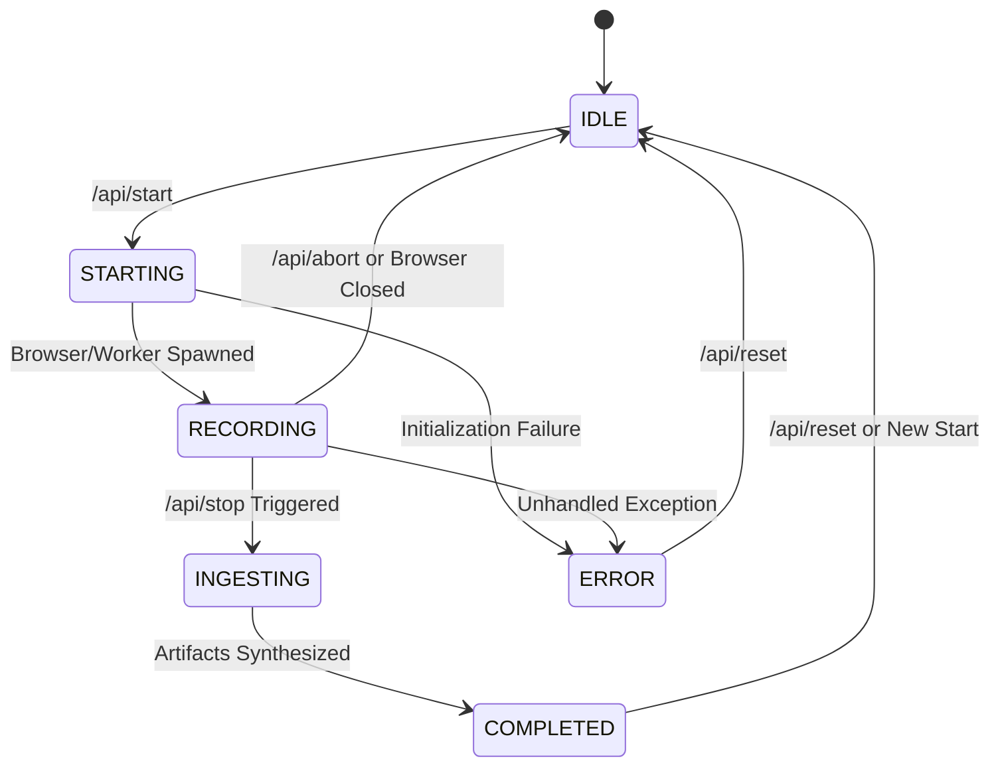

# Local Port Management, Socket Lifecycle & Session Architecture

All local HTTP control planes, test runners, recording studios, and interactive dashboards authored within this harness (e.g. `recorder_studio`, `security_cockpit`, `walkthrough_preview`) must strictly adhere to these port management and session handling standards.

---

## 1. Dedicated Local Port Allocation Register

To prevent port collisions across concurrent agent sessions and operator tools, the following dedicated local loopback ports are reserved:

| Port | Service / Surface | Script / Tool Path | Purpose & Access Mode |
|---|---|---|---|
| **`6769`** | **Telemetry & Warmup Logserver** | `tools/template_runner/boot_mct_logserver.py` | Embedded HTTP telemetry daemon, concurrency dials, and warmup-skip control plane. |
| **`8770`** | **UI Recorder Studio** | `tools/recorder_studio/server.py` | Standalone headed recording plane, Playwright trace extraction, and semantic action listener. |
| **`8780`** | **Walkthrough Preview Dashboard** | `templates/walkthrough_engine.py` | Local dual-pane scrollytelling preview and playback server. |
| **`8787`** | **Operator Panel / Orchestrator Cockpit** | `tools/operator_panel/server.py` | Multi-suite batch test orchestrator control surface, DAG planner, and live event stream monitor. |
| **`8790`** | **Security Cockpit** | `tools/security_cockpit/server.py`<br>*(or `redcraft cockpit`)* | TedRedCraft local security dashboard, finding explorer, report viewer, and upstream manager. |
| **`8771`–`8786`** | **Reserved Tooling Range** | `tools/*` | Reserved for auxiliary local inspection dashboards and proxy surfaces. |
| **`8000`–`8080`** | **Local Application Services** | Target service configs | Development service mock servers and local API test targets. |

---

## 2. Strict Loopback Binding & Socket Lifecycle

1. **Strict Loopback-Only Binding**:
   - Local tool servers must bind strictly to `127.0.0.1` (or `::1`).
   - Binding to `0.0.0.0` or wildcard interfaces is strictly prohibited on operator dashboards and developer tools to prevent unauthorized local network exposure.
   - Enforce loopback assertions via `socket.getaddrinfo()` and `ipaddress.is_loopback`.
2. **Immediate Socket Re-use (`SO_REUSEADDR`)**:
   - Always set `ThreadingHTTPServer.allow_reuse_address = True` before instantiating the socket.
   - This ensures rapid restarts during development and test loops without hanging in the TCP `TIME_WAIT` state.
3. **Graceful Teardown**:
   - Trap `KeyboardInterrupt` / SIGINT and ephemeral worker exits.
   - Cleanly close sockets via `server.server_close()` in guaranteed `finally:` blocks.

---

## 3. Port Conflict Detection & Actionable Auto-Recovery

When launching a local HTTP service, the server must trap socket binding errors (`OSError` with `errno.EADDRINUSE` or system error codes `48` on macOS and `98` on Linux) and provide immediate actionable options:

```python
ThreadingHTTPServer.allow_reuse_address = True
try:
    server = ThreadingHTTPServer((args.host, args.port), HandlerClass)
except OSError as exc:
    if exc.errno in (errno.EADDRINUSE, 48, 98):
        logger.error(f"[!] Bind Conflict: Port {args.port} is already in use on {args.host}.")
        logger.error("[*] An instance is likely already active.")
        logger.info("[*] Options:")
        logger.info(f"    • Access the active instance:  http://{args.host}:{args.port}/")
        logger.info(f"    • Stop the existing instance:  kill $(lsof -t -i :{args.port})")
        logger.info(f"    • Run on an alternate port:    python3 {sys.argv[0]} --port {args.port + 1}")
        return 1
    raise
```

---

## 4. Thread-Safe Session State Machine & Concurrency Interlocks

Interactive tools that manage stateful background workers (e.g. browser recording sessions, test suites, live probes) must implement a thread-safe session manager:



### Core Concurrency Invariants
1. **Thread Safety**: Wrap all state mutations inside `threading.Lock()`.
2. **Worker Auto-Healing**: If a previous worker thread terminated or crashed while the state remained active (`RECORDING`, `STARTING`, `INGESTING`), auto-recover state back to `IDLE` before evaluating new start requests:
   ```python
   if self.worker_thread and not self.worker_thread.is_alive():
       if self.status in ("RECORDING", "STARTING", "INGESTING"):
           logger.warning(f"Detected terminated worker thread with status '{self.status}'. Auto-recovering to IDLE.")
           self.status = "IDLE"
           self.error_msg = None
   ```
3. **Multi-Session Lockout (409 Conflict)**: Reject concurrent start requests if an existing session is running:
   ```python
   if self.status in ("RECORDING", "STARTING", "INGESTING"):
       return self._json(409, {"error": f"Session already active ({self.status}). Click 'Cancel / Reset' to abort."})
   ```
4. **Affirmative Abort & Teardown**:
   - Provide explicit `/api/.../abort` and `/api/.../reset` endpoints.
   - Signal `stop_event.set()` to worker loops, join threads with a gracious timeout (e.g. 3.0s–15.0s), and reset state.

---

## 5. Affirmative Production Mutation Interlock (`PROD-MUTATE`)

Tools capable of mutating remote environments must enforce a 3-step affirmative safety interlock:

1. Target environment check (`deployment in ("production", "prod", "cyberranges.com")`).
2. Mutating flag check (`allow_mutation == True`).
3. Explicit affirmative token verification: The operator must supply the exact confirmation token `PROD-MUTATE`.
   ```python
   is_prod = (deployment in ("production", "prod", "cyberranges.com"))
   if is_prod and allow_mutation:
       if prod_token != "PROD-MUTATE":
           return self._json(403, {
               "error": "Production mutation rejected: Missing or invalid affirmative token 'PROD-MUTATE'."
           })
       logger.warning("[SAFETY OVERRIDE] Operator armed single-session mutation on GLOBAL PRODUCTION with token 'PROD-MUTATE'.")
   ```

---

## 6. CSRF, Origin Defense & Payload Limits

Local web dashboards must protect themselves against malicious cross-origin requests from external browser tabs:

1. **Per-Process Dynamic CSRF Token**:
   - Generate a random 24-byte cryptographic token upon server boot: `secrets.token_urlsafe(24)`.
   - Inject the token dynamically into the dashboard HTML template (`__TOKEN_PLACEHOLDER__`).
   - Require mutating POST requests to include the token via header `X-Session-Token` or `X-Cockpit-Token`.
   - Validate using constant-time comparison: `hmac.compare_digest(token, server.token)`.
2. **Origin Header Whitelist**:
   - Inspect the incoming `Origin` header.
   - Restrict to loopback prefixes: `http://127.0.0.1`, `http://localhost`, `http://[::1]`.
3. **Payload Size Limit (`MAX_BODY_BYTES`)**:
   - Enforce an explicit request body ceiling (e.g., `MAX_BODY_BYTES = 1_048_576` / 1 MB) to prevent buffer exhaustion.

---

## 7. Automated Browser Session Resolution & Cookie Sanitization

When headed or headless browser automation requires existing portal sessions:

1. **Session Cache Resolution**:
   - Consult local encrypted session storage or cached credentials first (`SessionManager.get_valid_session()`).
   - If valid, extract cookie dictionaries; if invalid or expired, trigger automated headless re-authentication.
2. **Cookie Domain Sanitization**:
   - Ensure the cookie domain is properly prefixed with a leading dot (`.cyberranges.com`) for cross-subdomain compatibility.
3. **Playwright Context Injection**:
   - Inject normalized cookies into the browser context (`context.add_cookies(...)`) before navigating to the target portal.
4. **Fallback Resilience**:
   - If cookie resolution fails or encounters a network error, log a warning and allow the browser to navigate to the login page directly rather than crashing the harness.

---

## 8. Affirmative Artifact Synthesis & Telemetry Output

Upon session completion or recording shutdown:
1. Always resolve output paths to:
   `output/<deployment>/<tool>/<suite_tag>_<YYYY-MM-DD_HHMMSS>/`
2. Correlate UI actions with Wire HAR endpoints.
3. Emit:
   - `run-report.md` (or `ingestion_report.md`): Markdown summary with tabular action-to-wire mapping.
   - `wire_telemetry.json` / `wire.har`: Sanitized network traffic.
   - `trace.zip`: Playwright execution trace.
   - `verdict.json`: Conforming machine-readable execution verdict.

---

## 9. In-Tandem Server Daemon Lifecycle (`--dashboard` & `ensure_<tool>_running`)

Runners, test orchestrators, and security audit CLIs with an accompanying web dashboard must support zero-friction in-tandem startup via `--dashboard` (and `--port <N>`):

```python
def ensure_dashboard_running(host: str = "127.0.0.1", port: int = 8770) -> bool:
    """Ensures the local control plane is active; spawns a background daemon thread if not running."""
    with socket.socket(socket.AF_INET, socket.SOCK_STREAM) as sock:
        sock.settimeout(0.5)
        if sock.connect_ex((host, port)) == 0:
            logger.info(f"[*] Dashboard already active on http://{host}:{port}/")
            return True

    def _serve() -> None:
        ThreadingHTTPServer.allow_reuse_address = True
        try:
            httpd = ControlPlaneServer((host, port), ControlPlaneHandler)
            httpd.serve_forever()
        except Exception:
            pass

    t = threading.Thread(target=_serve, daemon=True)
    t.start()
    logger.info("=" * 70)
    logger.info(f"[*] Dashboard launched in tandem at http://{host}:{port}/")
    logger.info("=" * 70)
    time.sleep(0.3)
    return True
```
