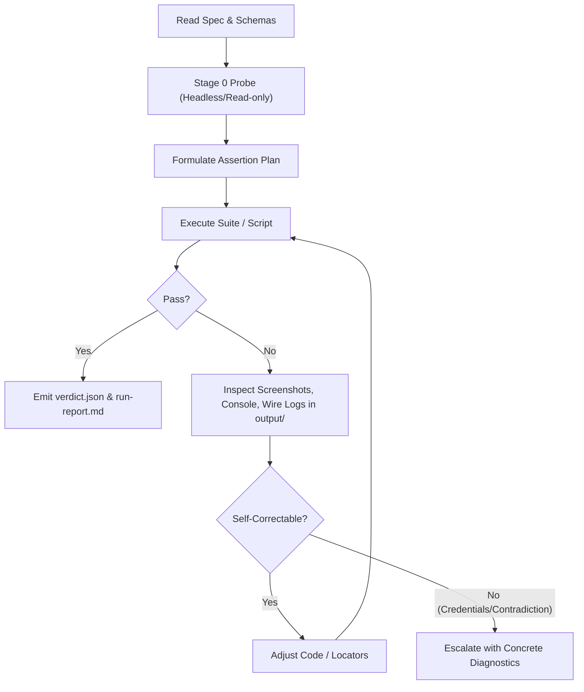

# Autonomous QA & End-to-End Verification Harness

This skill equips the agent to perform closed-loop autonomous verification across web applications, REST APIs, and infrastructure.

---

## 1. Operating Protocol



### Phase 1: Grounding & Stage 0 Probe
1. Inspect API definitions and specifications before drafting test code.
2. In browser testing, if a locator is ambiguous, inject a lightweight DOM dump script:
   ```javascript
   // Stage 0 Probe Script
   const elements = Array.from(document.querySelectorAll('button, input, select, [role="button"], .q-btn'))
     .map(el => ({
       tag: el.tagName,
       text: el.innerText?.trim()?.slice(0, 40),
       aria: el.getAttribute('aria-label'),
       id: el.id,
       classes: el.className
     }));
   console.log(JSON.stringify(elements, null, 2));
   ```
3. Capture empirical evidence rather than guessing.

### Phase 2: Asynchronous Convergence & Polling
When waiting for state changes, never use fixed sleeps without assertion loops:
```python
import time

def poll_for_state(fetch_fn, expected_state, timeout_sec=120, interval_sec=5):
    start = time.time()
    while time.time() - start < timeout_sec:
        current = fetch_fn()
        if current == expected_state:
            return True
        time.sleep(interval_sec)
    raise TimeoutError(f"Failed to reach {expected_state} within {timeout_sec}s. Last: {current}")
```

### Phase 3: Observability Output
Always emit a conforming `verdict.json` using the schema in `templates/verdict.schema.json`.
