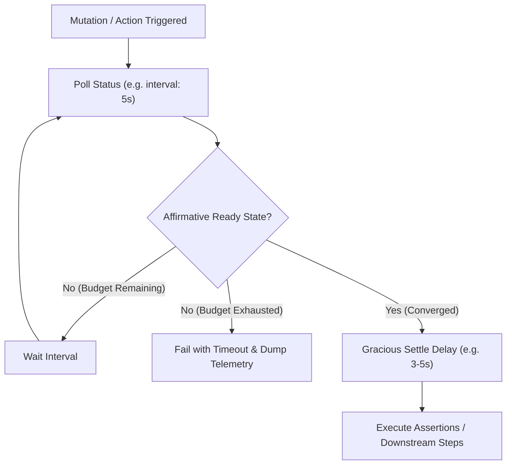

# Autonomous Engineering Harness (`HARNESS.md`)

**Repository:** NICE Framework Mapper  
**Harness Spec Version:** `1.0.0`  
**Scope:** Closed-loop autonomous execution, anti-hallucination protocols, empirical verification, and living lineage.

---

## 1. Core Mission: Zero-Supervision Autonomous Execution ("No Eye-Tour")

The goal of this harness is to enable the AI agent to operate with **zero supervision**:

1. **Schema Grounding**: Before writing code, suites, or migrations, inspect OpenAPI JSONs, database schemas, and contract specs. Never invent payload shapes or endpoints.
2. **Stage 0 Probe**: If UI elements, API responses, or backend states are uncertain, write and execute a lightweight, non-mutating probe (e.g. headless browser locator dump or schema probe) to discover reality on the ground.
3. **Self-Healing Loop**: If an execution fails, inspect the generated logs, screenshots, and wire traces in `output/`, self-correct the code or locators, and re-execute.
4. **Escalation Policy**: Only pause to ask the operator when blocked by:
   - Missing or expired environment credentials / VPN access
   - Hard contradiction between authoritative specification and live backend behavior
   - Irrevocable destructive action on an unverified environment

---

## 2. Architectural Lineage Log

Track key architectural pivots so future agents and contributors never regress to solved anti-patterns:

| Milestone / Version | Date | Target / Area | Problem Solved & Engineering Pattern Adopted |
|---|---|---|---|
| `1.0.0` | Initial | Architecture Core | Standardized closed-loop execution harness, Stage 0 DOM probes, `verdict.json` observability schema, and dynamic deployment resolution. |
| `1.1.0` | Security & Ports | Security & Ports Core | Integrated TedRedCraft (`https://github.com/teddymwai/TedRedCraft`) 3-tier polyglot SAST/DAST, 4 disciplined rules, loopback scope lock, and dedicated port/session control plane (`recorder_studio` architecture). |
| `1.2.0` | Current | Full SDLC, Interactive Dashboards & UltraRed Reporting | Codified the 7-capability Interactive Operator Dashboard Mandate (`operator_panel`, `recorder_studio`, `security_cockpit`), `--dashboard` in-tandem daemon lifecycle, Studio Curve (`img001.jpg`) composite canvas, position-aware `TooltipManager`, UltraRed `<projectTitle>_<YYYYMMDD_HHMMSS>/mainReport.md` engine (ARTEX 7-Check Oracle), and the 5-Stage SDLC & 7-Check Pre-Commit Promotion Gate (`docs/push2git.md`). |

---

## 3. Asynchronous Convergence & Settle Budgets

Distributed backends, cloud orchestrators, container boots, and SPA view transitions require non-zero physical time to converge.



### Convergence Rulebook
1. **Never Assert Immediately**: Always implement explicit polling loops with configured timeout budgets.
2. **Prevent Thrashing**: Tight polling loops (<2s) waste CPU, spam rate-limiters, and produce false negatives.
3. **Gracious Settle Windows**:
   - UI / Route Transitions: 3000ms–6000ms post-render delay.
   - Microservices & Containers: 15s–30s post-healthcheck before heavy load verification.
   - Affirmative Teardown: Always poll for resource deletion confirmation (`404` or `TERMINATED`) before proceeding.

---

## 4. Observability Contract (`verdict.json`)

Every autonomous test suite or automated workflow must write a machine-readable `verdict.json` to its timestamped output directory.

### Conforming Schema Structure
```json
{
  "version": "1.0.0",
  "suite": "SUITE_NAME_OR_CODE",
  "deployment": "staging",
  "run_id": "2026-11-18_163000_abc123",
  "status": "PASS",
  "duration_seconds": 14.82,
  "summary": "Discrete summary of execution results and invariants verified",
  "checks": [
    {"name": "stage_0_probe", "status": "PASS", "detail": "DOM attributes captured successfully"},
    {"name": "affirmative_verification", "status": "PASS", "detail": "Entity verified via dual wire check"}
  ],
  "telemetry": {
    "redaction_applied": true,
    "screenshots_count": 2,
    "wire_requests_count": 14
  }
}
```

---

## 5. TedRedCraft Universal Security Harness & Multi-Stage Advisory

All repositories and agent sessions operating under this harness integrate the **TedRedCraft** (`redcraft`) security platform:

- **Private Repository URI**: `https://github.com/teddymwai/TedRedCraft`
- **Canonical Workstation Clone**: `/Users/ted/Development/TedRedCraft`
- **Core Engine**: 100% Python 3.11+ Standard Library (Zero External Dependencies).

### Multi-Stage Security Execution Advisory

```
                       Continuous Upstream Distillation Pipeline
   ┌─────────────────────────────────────────────────────────────────────────────────┐
   │ Loop C: Ingest upstream repositories -> Evaluate Net-Gain vs. Tech-Load Dossier │
   │         Run held-out falsification battery (100% recall, 0% FP)                 │
   │         Attested Promotion (status = "agreed <YYYY-MM-DD>" in decisions.jsonl)  │
   └────────────────────────────────────────┬────────────────────────────────────────┘
                                            │
   ┌────────────────────────────────────────▼────────────────────────────────────────┐
   │ Tier 1: Fast Polyglot SAST (<1.5s pre-commit, Python/Go/JS/TS/Shell/Docker)     │
   │ Tier 2: Ephemeral Loopback DAST + Taint Probes + Canary DemoTarget (<4s)        │
   │ Tier 3: Cairn Conclude Recovery + SQLite Dual-Graph + TF-IDF Retrieval          │
   │ Cockpit: Local Web UI (127.0.0.1:8790, Deep Forest Green, Strict Token/CSP)     │
   └─────────────────────────────────────────────────────────────────────────────────┘
```

1. **Development Stage (`in-dev`)**:
   - `python3 -m redcraft selftest` (<3s offline unit benchmark).
   - `python3 -m redcraft search "<query>"` (BM25/TF-IDF retrieval against `.redcraft/blackboard.db`).
   - Enforce loopback scope: `assert_local_loopback_scope(host)` before opening network sockets.
2. **Pre-Commit Stage (`pre-commit`)**:
   - `python3 -m redcraft audit --target . --mode pre-commit` (<1.5s).
   - Scans staged diffs for unredacted secrets, dangerous sinks (`eval`, `exec`, `subprocess`), unconfined path joins (`os.path.join` with untrusted input), `.har` cookie leaks, and missing CSRF tokens.
3. **Pre-Push Stage (`pre-push`)**:
   - `python3 -m redcraft audit --target . --mode pre-push` (<4s).
   - Probes running loopback HTTP servers, CSRF defenses, Origin headers, tokens, and ephemeral socket closeout.
4. **Live Usage & Deep Audit Stage (`deep-audit` / Cockpit)**:
   - `python3 -m redcraft audit --target . --mode deep-audit`.
   - `python3 -m redcraft cockpit --port 8790` (loopback web UI with per-session CSRF token, CSP, and interactive finding explorer).
5. **Continuous Upstream Distillation (Loop C)**:
   - `python3 -m redcraft upstream ingest <slug>` -> Staged as `observed`.
   - Falsification battery -> Attested promotion via `python3 -m redcraft upstream promote <slug>`.

### The 4 Disciplined Rules & 3 Hard Gates
- **Rule 1 (Scope-Lock)**: Probing remote infrastructure is architecturally impossible. Target hostnames are resolved via `socket.getaddrinfo()` to verify `ipaddress.is_loopback`.
- **Rule 2 (Anti-Hallucination Rubric)**: Findings are `CONFIRMED`, `CANDIDATE`, `DISPROVED`, or `HARDENING_NOTE`. Eliminations require evidence at the same standard as confirmations.
- **Rule 3 (Root-Cause 3-Tuple Dedup)**: Group redundant findings by `(root_cause, component, prerequisite)`.
- **Rule 4 (Bounded Leases)**: Loopback HTTP servers run in ephemeral leases that tear down sockets in `finally:` blocks.
- **VulnHunter 3 Hard Gates**: Issue confirmed only if proven **Reachable**, **Attacker-Controlled**, and granting a **New Capability**.

---

## 6. Local Port Management, Socket Lifecycle & Thread-Safe Session Architecture

Local tool servers (e.g. `recorder_studio`, `security_cockpit`, `walkthrough_preview`) must follow the architecture established in `CYBER RANGES Agents/tools/recorder_studio/server.py`:

### A. Dedicated Port Matrix
- `6769`: Embedded Telemetry & Warmup Logserver (`tools/template_runner/boot_mct_logserver.py`)
- `8770`: UI Recorder Studio & Semantic Ingestion Server (`tools/recorder_studio/server.py`)
- `8780`: Walkthrough Preview Dashboard (`templates/walkthrough_engine.py`)
- `8787`: Operator Panel & Nightly Orchestrator Cockpit (`tools/operator_panel/server.py`)
- `8790`: Security Cockpit (`tools/security_cockpit/server.py`)
- `8771`–`8786`: Reserved Tooling Range
- `8000`–`8080`: Local Application Mock Services

### B. Socket Lifecycle & Port Collision Recovery
- Bind strictly to `127.0.0.1` (or `::1`). Never bind `0.0.0.0` on local engineering dashboards.
- Always set `ThreadingHTTPServer.allow_reuse_address = True` (`SO_REUSEADDR`) before socket bind.
- Catch `OSError` (`errno.EADDRINUSE` / 48 / 98) and log immediate diagnostic options:
  - Active URL: `http://{host}:{port}/`
  - Terminate conflicting process: `kill $(lsof -t -i :{port})`
  - Alternate port fallback: `--port {port + 1}`

### C. Thread-Safe Session State Machines
- State transitions: `IDLE` $\rightarrow$ `STARTING` $\rightarrow$ `WORKING`/`RECORDING` $\rightarrow$ `INGESTING` $\rightarrow$ `COMPLETED` (or `ERROR`).
- State mutations wrapped in `threading.Lock()`.
- Auto-heal dead worker threads back to `IDLE` before accepting new start commands.
- Overlapping start requests return `409 Conflict`.
- Affirmative `/api/.../abort` and `/api/.../reset` endpoints signal `threading.Event`, join worker threads with timeout, and reset state.

### D. Production Mutation Safety Interlock (`PROD-MUTATE`)
Mutations against production (`deployment in ("production", "prod", "cyberranges.com")`) require an explicit confirmation token: `prod_mutation_token == "PROD-MUTATE"`. Unauthorized requests are rejected with `403 Forbidden`.

### E. CSRF Defense, Origin Whitelisting & Payload Limits
- Generate per-process dynamic CSRF tokens (`secrets.token_urlsafe(24)`).
- Inject into served HTML (`__TOKEN_PLACEHOLDER__`) and validate with constant-time `hmac.compare_digest()`.
- Enforce loopback Origin whitelist (`http://127.0.0.1`, `http://localhost`, `http://[::1]`).
- Cap request body sizes at `MAX_BODY_BYTES = 1_048_576` (1 MB).
- Confine all file-serving paths via `target.resolve().is_relative_to(base_dir.resolve())` (`SEC-01`) and escape dynamic DOM strings (`SEC-JS-INNER-HTML`).

### F. Interactive Dashboard & In-Tandem Server Contract
Every tool dashboard (`tools/<tool>/static/<tool>_dashboard.html`) must implement all 7 interactive capabilities (reference implementation in `templates/server_boilerplate.py` and `templates/dashboard_boilerplate.html`):
1. **Run Creation & Target Configuration Deck** (dynamic deployments, inline onboarding, suite/task tabs & filter pills, DAG `/api/plan` preview, operator identity input, and `PROD-MUTATE` safety interlock).
2. **Active Lifecycle Controls & Multi-Session `409` Recovery** (44x44px Apple HIG capsules, dead-thread `auto_heal()`, and a one-click **`Force Reset & Abort Active Session`** UI banner on `409 Conflict`).
3. **Full State Hydration Across Page Refresh** (restores target, mutation toggles, running step matrix, and event `seq` cursor on reload).
4. **Live Output & Event Stream Monitor** (`1.5s–2.0s` incremental polling of `/api/runs/<id>/events?since=<seq>` and `/api/launch-log`).
5. **Run History & In-App Report Drawer** (renders `run-report.md` / `mainReport.md` and `verdict.json` in-app, synthesizing missing markdown reports on demand from `verdict.json` so report links never 404).
6. **In-Tandem Daemon Lifecycle (`--dashboard` & `ensure_<tool>_running`)** (`socket.connect_ex` pre-flight check + background daemon thread + 70-char `=` console banner).
7. **Resilient `file://` Offline Preview & UI Craft** (synchronous DOM listener setup before network fetches, Studio Curve `img001.jpg` composite canvas without redundant theme dropdowns, position-aware `TooltipManager`, and CLI reference footer).

---

## 7. Offline Selftest Benchmark & 7-Check Pre-Commit Gate

Before committing or completing a task, the agent must run self-validation commands to ensure no syntactical, contract, or security regressions:

```bash
# 1. Full-tree syntax and bytecode compilation check
python3 -m compileall lib/ tools/ tests/ templates/ -q 2>/dev/null || python3 -m compileall -q .

# 2. Automated template & harness selftests (1:1 registry/manifest/spec-on-disk parity & AST boundaries)
python3 templates/tool_boilerplate.py --selftest
python3 templates/server_boilerplate.py --selftest
python3 templates/ultrared_reporting.py --selftest

# 3. TedRedCraft security benchmark, Tier 1 Pre-Commit SAST (<1.5s) & Tier 2 Pre-Push DAST (<4s)
PYTHONPATH=/Users/ted/Development/TedRedCraft python3 -m redcraft selftest
PYTHONPATH=/Users/ted/Development/TedRedCraft python3 -m redcraft audit --target . --mode pre-commit
```

---

## 8. Software Release, SDLC & Platform Tie-Break Invariants

When managing versions, releases, security, dashboards, or networking, agents must enforce these platform invariants:

| Invariant ID | Domain | Ambiguity / Pitfall | Ground Truth & Enforced Rule |
|---|---|---|---|
| `INV-REL-01` | Release Tagging | Generic version tags (`v1.2.0`, `release-1.2`) | Strictly prohibited. Must follow Ptarmigan (*Lagopus*) taxonomy: `Lagopus[Species][Subspecies]_vMAJOR.MINOR.PATCH[-STAGE.N]`. |
| `INV-REL-02` | Patch / Promotion Lineage | Subspecies reassigned on patch bump | Patch bumps (`v2.1.0` $\rightarrow$ `v2.1.1`) and pre-release promotions (`-rc.1` $\rightarrow$ GA) must retain the parent taxon verbatim. |
| `INV-REL-03` | Release Register Sync | Tag pushed without register entry or GitHub Release | Every git tag must be recorded synchronously in `docs/RELEASE_REGISTER.md` and published to GitHub Releases (`gh release create`) with verbose release notes. |
| `INV-REL-04` | Species Mapping | Inconsistent species token assignment | `v1.x` = `Lagopus`, `v2.x` = `LagopusMuta`, `v3.x` = `LagopusLeucura`, `v4.x` = `LagopusScotica`. |
| `INV-SEC-01` | Security / DAST Probes | Scanning remote staging/prod targets | Strictly enforce `assert_local_loopback_scope(host)`. Resolve via `socket.getaddrinfo()` and check `ipaddress.is_loopback`. Remote active scanning is strictly blocked. |
| `INV-SEC-02` | Security / Findings Triage | False-positive vulnerability reports | Never mark `CONFIRMED` without satisfying VulnHunter's 3 Hard Gates (Reachable, Attacker-Controlled, New Capability) and 5-Lens Adversary review. Eliminations require equal evidence. |
| `INV-SEC-03` | Security / Local Web Surfaces | Cross-origin hijacking, path traversal & DOM XSS | Bind `127.0.0.1`, issue per-process CSRF tokens, check `hmac.compare_digest`, enforce loopback Origin headers, confine paths via `.resolve().is_relative_to()`, cap body reads at 1MB, and escape DOM `innerHTML`. |
| `INV-SEC-04` | Security / Git Gates | Unverified code pushed to repository | Pre-commit must pass Tier 1 SAST (<1.5s); pre-push must pass Tier 2 ephemeral loopback DAST (<4s). |
| `INV-NET-01` | Networking / Port Binding | Local dashboard bound to `0.0.0.0` | Strictly prohibited. Local dashboards and recording planes must bind exclusively to `127.0.0.1` or `::1`. |
| `INV-NET-02` | Networking / Port Collisions | Server crash on `EADDRINUSE` | Catch `errno.EADDRINUSE` (POSIX 48/98), log `kill $(lsof -t -i :PORT)` recovery command, and provide `--port` increment fallback. |
| `INV-NET-03` | Concurrency / Worker Threads | Zombie threads locking server state | Wrap session state in `threading.Lock()`, auto-heal dead worker threads back to `IDLE`, and return `409 Conflict` on overlapping start calls. |
| `INV-NET-04` | Safety / Production Mutations | Accidental state mutation on production | Require affirmative token `PROD-MUTATE` and reject unauthorized requests with `403 Forbidden`. |
| `INV-UI-01` | Dashboards / Interactivity | Passive "decorative tech-debt" dashboards | Every dashboard must support interactive run creation, live event tailing, 409 one-click reset, state hydration on page refresh, and in-app report rendering with on-demand markdown synthesis fallback. |
| `INV-UI-02` | Dashboards / Daemon Lifecycle | Manual multi-terminal server startup friction | Support `--dashboard` on CLIs via `ensure_<tool>_running()` (`socket.connect_ex` pre-flight check + background daemon thread + 70-char `=` startup banner). |
| `INV-UI-03` | Dashboards / Canvas & Tooltips | Theme-selector clutter & clipped tooltips | Standardize on Studio Curve (`img001.jpg`) composite canvas (`file://` fallback, zero theme dropdowns), position-aware `TooltipManager` (`top: -9999px` init + boundary flip), and inline left brand icon / right port badges. |
| `INV-ARC-01` | Architecture / Seams & Imports | Seam rot & root-shim circular imports | CLI is 1st consumer of every contract seam; internal modules (`lib/framework/`, `lib/suites/`) never import root shims; enforce 1:1 registry, `manifest.toml`, and physical `specs/` parity. |
| `INV-ARC-02` | Testing / Dynamic Fixtures | Hardcoded tenant IDs & teardown dependency bugs | Discover assets dynamically or self-provision `pw-tc-<hex8>` fixtures; tear down child entities before parent entities; never auto-delete non-`pw-tc-` entities. |
| `INV-GIT-01` | Git / Staging & Pre-Commit | Unstaged secrets or missing tests/docs | Never run `git add -A` or `git add .`; stage explicit paths; ship tests and 5-section `README.md` with the feature; pass all 7 pre-commit sanitization gates (`docs/push2git.md`). |
| `INV-GIT-02` | Git / Commits & Promotion | Unstructured commit messages & `GH013` tag locks | Format commits with `type(scope)` + `Why:` / `Trade-off:` / `Touches:` (preserving operator-specified subjects verbatim); promote `beta/unstable-nightly` $\rightarrow$ `staging` $\rightarrow$ `--ff-only` `main`; use Commit-and-Purge for legacy scripts and `gh release delete --cleanup-tag` for `GH013`. |


